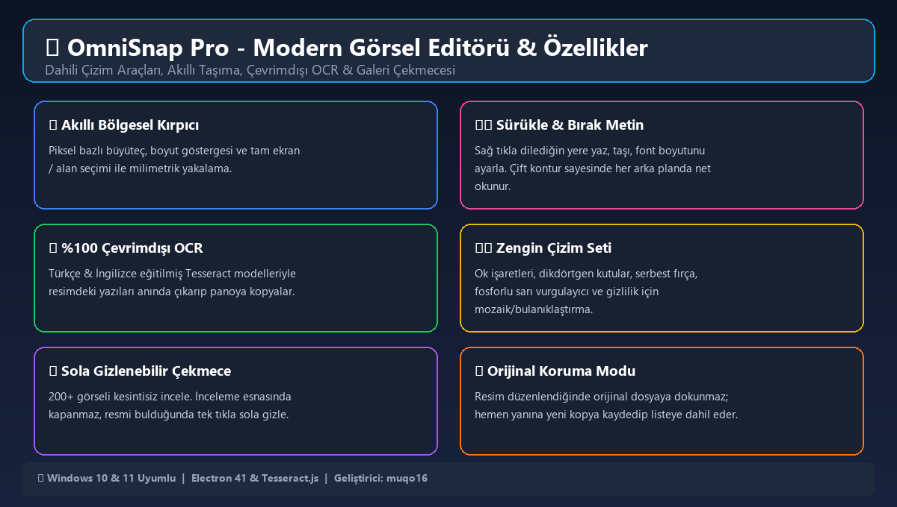
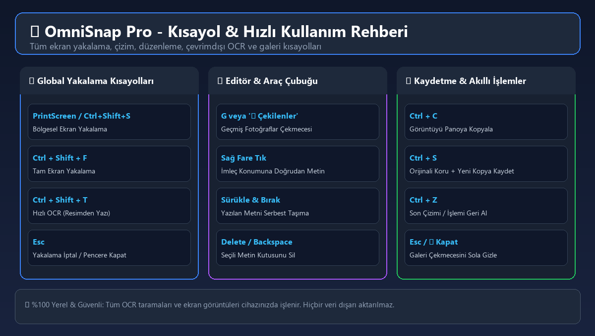

# 📸 OmniSnap Pro

<p align="center">
  
</p>

<p align="center">
  <a href="https://github.com/muqo16/omnisnap-pro/releases/latest"></a>
  
  
  
  
</p>

---

## ⚡ İndirme Seçenekleri (Releases)

Windows işletim sisteminiz için hazır derlenmiş kurulum dosyasını veya kurulum gerektirmeyen taşınabilir sürümü tek tıkla indirebilirsiniz:

| Paket Türü | Açıklama | İndirme Bağlantısı |
| :--- | :--- | :--- |
| 🚀 **Kurulumlu Sürüm (Setup.exe)** | Klasik Windows kurulum sihirbazı ile yükler, masaüstü kısayolu oluşturur. | [📥 OmniSnap.Pro.Setup.1.0.0.exe](https://github.com/muqo16/omnisnap-pro/releases/download/v1.0.0/OmniSnap.Pro.Setup.1.0.0.exe) |
| 📦 **Taşınabilir Sürüm (Portable .zip)** | Kurulum gerektirmez. ZIP'ten çıkarıp doğrudan `OmniSnap Pro.exe` ile çalıştırın. | [📥 OmniSnap-Pro-v1.0.0-Portable.zip](https://github.com/muqo16/omnisnap-pro/releases/download/v1.0.0/OmniSnap-Pro-v1.0.0-Portable.zip) |

---

## 🌟 Öne Çıkan Özellikler

### 🎯 1. Akıllı & Milimetrik Ekran Yakalama
- **Bölgesel Yakalama (`PrintScreen` veya `Ctrl + Shift + S`):** Ekranda istediğiniz alanı fare ile seçin.
- **Canlı Büyüteç & Piksel Boyut Göstergesi:** Seçim esnasında imlecin etrafında piksel büyüteci ve genişlik x yükseklik (px) anlık gösterilir.
- **Tam Ekran Yakalama (`Ctrl + Shift + F`):** Tüm ekranı anında yakalar ve düzenleyiciye aktarır.

### 🎨 2. Güçlü Çizim & Düzenleme Araçları
- ➡️ **Ok İşareti (Arrow):** Dikkat çekmek istediğiniz nesneleri yön gösteren oklarla işaretleyin.
- 🔲 **Dikdörtgen / Kutu (Rect):** Önemli alanları çerçeve içine alın.
- ✏️ **Serbest Çizim Kalemi (Pen):** Pürüzsüz serbest çizimler yapın.
- 🖍️ **Fosforlu Kalem (Highlight):** Metinlerin ve satırların üzerini yarı saydam vurgulayıcıyla çizin.
- 🌫️ **Mozaik / Bulanıklaştırma (Blur):** Şifreleri, kimlik bilgilerini veya gizli kısımları tek hamlede mozaikleyerek gizleyin.
- 🎨 **Geniş Renk Paleti & Çizgi Kalınlığı:** Kırmızı, mavi, yeşil, sarı, mor, beyaz vb. renkler ve ayarlanabilir fırça boyutları.

### ✍️ 3. Gelişmiş & Sürükle-Bırak Metin Katmanı
- **Sağ Tık ile Doğrudan Yazma:** Resmin üzerine farenin sağ tuşuyla tıkladığınız anda doğrudan metin kutusu açılır.
- **Sürükle & Bırak ile Konumlandırma:** Yazdığınız metni sol fare tuşuyla tutup görselin istediğiniz yerine özgürce taşıyabilirsiniz.
- **Çift Kontur & Kontrast Koruması:** Siyah ve koyu renkli metinlerin etrafına otomatik beyaz kontur eklenir; böylece metin hem beyaz hem siyah hem de renkli zeminlerde kusursuz şekilde okunur.
- **Esnek Boyutlandırma:** 16px'den 72px'e kadar dilediğiniz font boyutunu seçin.

### 🔍 4. %100 Çevrimdışı OCR (Görselden Metin Çıkarma)
- **Tesseract.js Entegrasyonu:** Türkçe (`tur.traineddata`) ve İngilizce (`eng.traineddata`) modelleri uygulamanın içine gömülüdür.
- **İnternetsiz Çalışma:** Herhangi bir bulut servisine, harici API'ye veya internet bağlantısına ihtiyaç duymaz.
- **Otomatik Panoya Kopyalama:** Ekrandan taranan metin anında panoya (Clipboard) aktarılır, `Ctrl + V` ile dilediğiniz yere yapıştırabilirsiniz.

### 📂 5. Kesintisiz Galeri & Sola Gizlenebilir Çekmece
- **Arka Planı Kapatmayan Çekmece:** Sol tarafta açılan fotoğraflar çekmecesi, yüzlerce ekran görüntüsü arasında gezinirken kendiliğinden kapanmaz.
- **Anlık Kanvas Önizlemesi:** Çekmecedeki küçük resimlere tıkladıkça arka plandaki ana görsel anında güncellenir.
- **Sola Kapatma:** İstediğiniz fotoğrafı bulduğunuzda `◀ Kapat` butonuyla, `Esc` tuşuyla veya resmin üzerine tıklayarak çekmeceyi sola doğru kapatabilirsiniz.
- **Sığdır / %100 Görünüm:** Görseli ekranınıza tam sığdırabilir veya orijinal piksel boyutunda inceleyebilirsiniz.

### 💾 6. Orijinal Resmi Koruyarak Kaydetme
- Bir ekran görüntüsü üzerinde değişiklik yapıp `Kaydet` dediğinizde orijinal resim asla bozulmaz veya silinmez.
- Düzenlenen görsel orijinal dosyanın hemen yanına `_duzenlendi` ekiyle yeni bir kopya olarak kaydedilir ve anında sol çekmece listesine eklenir.

---

## ⌨️ Kısayol Tuşları & Kullanım Rehberi

<p align="center">
  
</p>

### Global Kısayollar (Her Yerden Çalışır)
| Kısayol | İşlev |
| :--- | :--- |
| `PrintScreen` veya `Ctrl + Shift + S` | **Bölgesel Ekran Yakalama** (Alanı fareyle seçin) |
| `Ctrl + Shift + F` | **Tam Ekran Yakalama** (Ekranın tamamını kaydeder ve açar) |
| `Ctrl + Shift + T` | **Hızlı OCR Taraması** (Resimdeki yazıları okur ve panoya kopyalar) |

### Editör & Galeri Kısayolları
| Kısayol / Eylem | İşlev |
| :--- | :--- |
| `G` veya `📸 Çekilenler` | Çekilen geçmiş fotoğraflar çekmecesini aç / kapat |
| `Sağ Tık (Right Click)` | Tıklanan noktaya anında metin kutusu aç |
| `Sol Tıkla Sürükle` | Yazılan metni ekranda dilediğin yere taşı |
| `Delete` / `Backspace` | Seçili durumdaki metin kutusunu sil |
| `Ctrl + C` | Görseli panoya kopyala (Doğrudan WhatsApp, Discord vb. yapıştırılabilir) |
| `Ctrl + S` | Orijinali koruyarak yeni kopya olarak kaydet |
| `Ctrl + Z` | Yapılan son çizimi / işlemi geri al |
| `Esc` veya `◀ Kapat` | Galeri çekmecesini kapat / Seçimi iptal et / OCR penceresini kapat |

---

## 🛠️ Kaynak Koddan Çalıştırma & Derleme (Geliştiriciler İçin)

Eğer projeyi yerel ortamınızda kaynak koddan çalıştırmak veya kendiniz derlemek isterseniz:

```bash
# 1. Projeyi klonlayın
git clone https://github.com/muqo16/omnisnap-pro.git
cd omnisnap-pro

# 2. Bağımlılıkları yükleyin
npm install

# 3. Geliştirici modunda başlatın
npm start

# 4. Windows için Setup (.exe) derlemesi alın
npm run build
```

Derlenen kurulum dosyaları `build/` dizini altında oluşturulur:
- `build/OmniSnap Pro Setup 1.0.0.exe` (Windows Kurulum Paketi)
- `build/win-unpacked/` (Kuruluma gerek olmadan çalışan paket)

---

## 🔒 Gizlilik ve Güvenlik Bildirimi

- **Sıfır Telemetri:** Uygulama hiçbir analitik veri, kullanım istatistiği veya log toplamaz.
- **Tamamen Yerel:** Alınan ekran görüntüleri yalnızca bilgisayarınızdaki `Resimler\OmniSnap Pro` (veya `ScreenshotTool`) klasöründe saklanır.
- **Çevrimdışı OCR:** Optik Karakter Tanıma (OCR) işlemi yerel Tesseract motoru ve bilgisayarınızdaki dil modelleri ile tamamen internetsiz çalışır.

---

## 📄 Lisans
Bu proje [MIT Lisansı](LICENSE) kapsamında açık kaynak olarak paylaşılmıştır.

**Geliştirici:** [@muqo16](https://github.com/muqo16)
